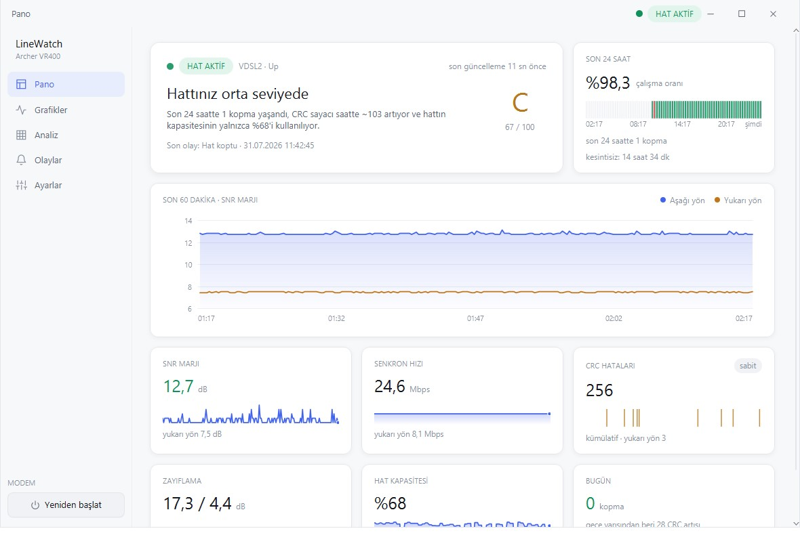
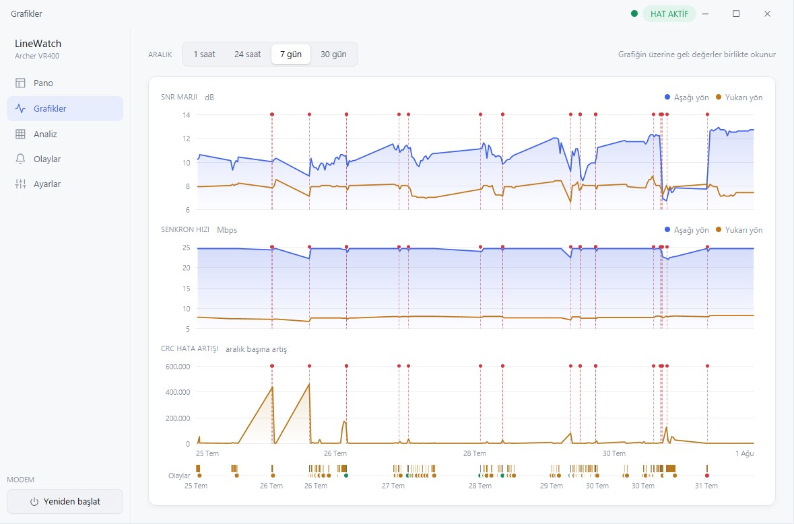
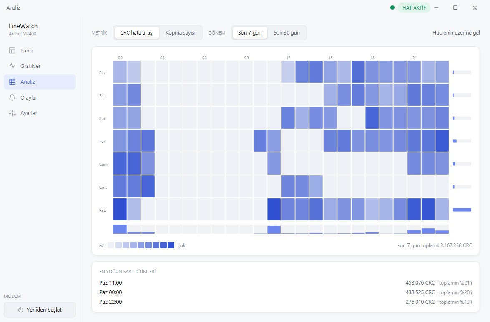
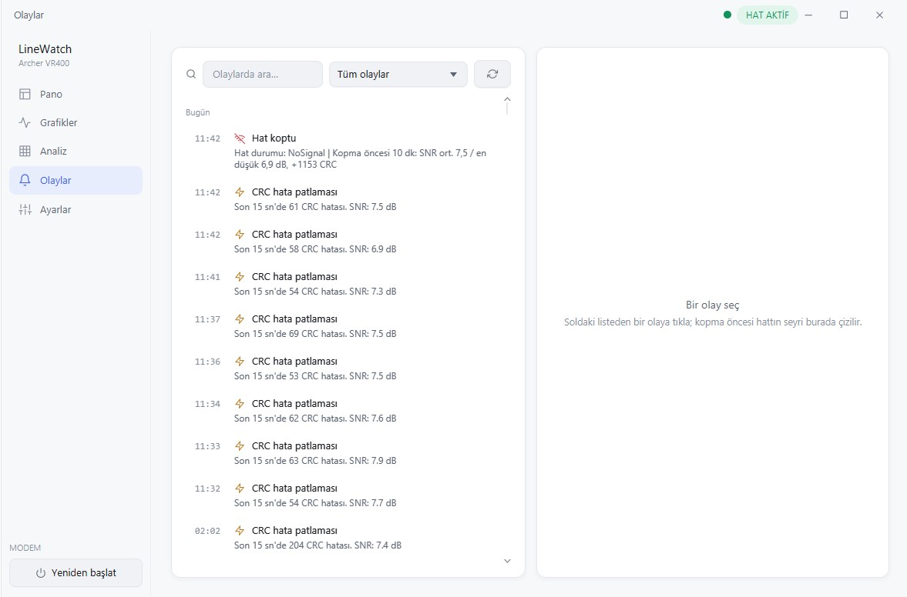
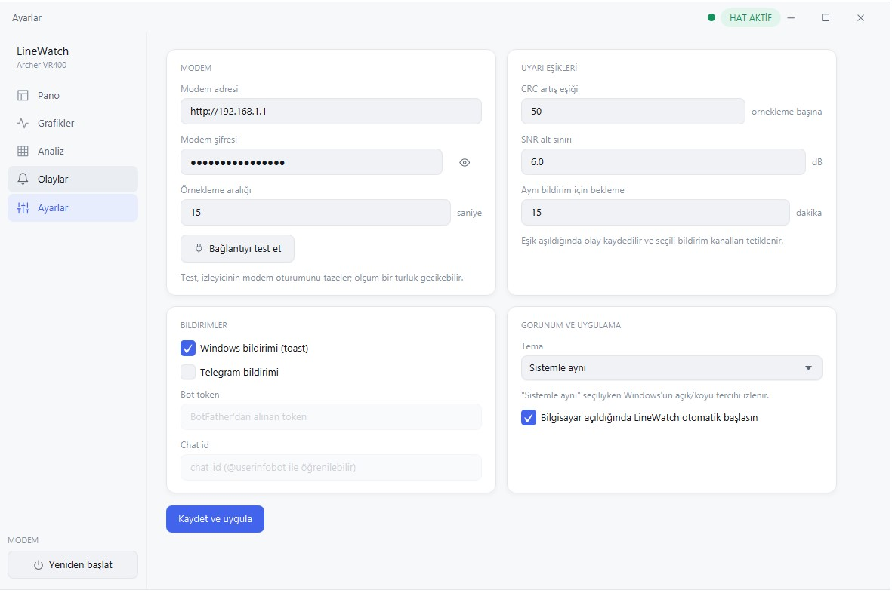

# LineWatch

**DSL hattın ne zaman, ne kadar ve neden bozuluyor — kanıtıyla.**

[](https://github.com/byFischer/LineWatch/releases/latest)
[](https://github.com/byFischer/LineWatch/actions/workflows/ci.yml)
[](LICENSE)

LineWatch iki şeyi ölçer ve geçmişini tutar:

- **İnternet kalitesi** — gecikme, jitter, paket kaybı ve kesintiler. **Modem markası
  fark etmez, herkeste çalışır.**
- **DSL hat kalitesi** — SNR marjı, senkron hızı, zayıflama, CRC/FEC hata sayaçları.
  Desteklenen TP-Link modemlerde.

Ölçümler 15 saniyede bir alınır, SQLite'a yazılır, grafiklerle gösterilir; hat
koptuğunda, sinyal düştüğünde, gecikme fırladığında ya da paket kaybı başladığında
Windows bildirimi ve Telegram mesajı gönderilir. Sistem tepsisinde arka planda çalışır.



## İndir ve çalıştır

1. [**Son sürümü indir**](https://github.com/byFischer/LineWatch/releases/latest) →
   `LineWatch-x.y.z-windows-x64.zip`
2. Zip'i istediğin klasöre çıkar. **Java kurulumu gerekmez**, çalışma zamanı paketin
   içinde.
3. `LineWatch.exe`'ye çift tıkla.

> [!NOTE]
> **"Windows bilgisayarınızı korudu" uyarısı alman normal.** Uygulama kod imzalama
> sertifikasıyla imzalanmadığı için (sertifika yıllık ücretli) SmartScreen ilk
> çalıştırmada uyarır. **Ek bilgi** → **Yine de çalıştır** ile devam edebilirsin.
> İndirdiğin dosyanın bozulmadığını release'deki `SHA256SUMS.txt` ile doğrulayabilirsin.

Java'sı olanlar için `LineWatch-x.y.z.jar` da release'e ekleniyor:
`java -jar LineWatch-x.y.z.jar`

## Uyumluluk

| Özellik | Gereksinim |
|---|---|
| **İnternet izleme** (gecikme, jitter, paket kaybı, kesinti geçmişi) | Yok — her modem, her bağlantı türü. Fiber, kablo, mobil fark etmez |
| **DSL hat izleme** (SNR, senkron hızı, zayıflama, CRC) | TP-Link **Archer VR400** (doğrulandı) |
| DSL izleme — muhtemelen çalışır | Aynı `/cgi_gdpr` protokolünü kullanan diğer TP-Link VDSL modemleri (test edilmedi) |
| **İşletim sistemi** | Windows 10 / 11 (x64) |

Modemin desteklenmiyorsa uygulama yine kurulur ve çalışır: internet kalitesi izleme
tek başına anlamlıdır. **Ayarlar → Modem izleme**'yi kapatman yeterli — Pano, Grafikler
ve Olaylar internet ölçümleriyle dolar.

> [!IMPORTANT]
> Farklı bir TP-Link modelinde denediysen — çalışsın ya da çalışmasın —
> [issue açıp](https://github.com/byFischer/LineWatch/issues) modelini ve sonucu
> yazabilirsin. Desteklenen modem listesini genişletmenin en hızlı yolu bu.

## İlk kurulum

Uygulama açılır açılmaz internet ölçümüne başlar — hiçbir ayar yapmadan Pano dolmaya
başlar. DSL hat verilerini de görmek istiyorsan **Ayarlar** ekranından modemi tanıt:

1. **Modem izleme** kutusunu işaretle.
2. **Modem adresi** — genelde `http://192.168.1.1` (varsayılan olarak dolu gelir).
3. **Modem şifresi** — modemin web arayüzüne girdiğin şifre. *Wi-Fi şifresi değil.*
4. **Bağlantıyı test et** → "bağlantı başarılı · VDSL2 · SNR 11.7 dB" gibi bir yanıt
   görmelisin.
5. **Kaydet ve uygula**.

Modemin desteklenmiyorsa **Modem izleme**'yi kapalı bırak; uygulama internet
ölçümüyle çalışmaya devam eder.

> [!WARNING]
> Modem **5 yanlış şifre denemesinden sonra 10 dakika kilitlenir.** Şifreden emin
> değilsen önce tarayıcıdan modem arayüzüne girip doğrula.

> [!NOTE]
> Modem aynı anda tek web oturumu tutar. Tarayıcıdan modem arayüzüne girersen
> LineWatch'un oturumu düşer — uygulama bunu fark edip otomatik yeniden bağlanır,
> bir ölçüm turu gecikebilir.

Pencereyi kapatmak uygulamayı kapatmaz, tepsiye küçültür. Tamamen kapatmak için tepsi
simgesine sağ tıkla → **Çıkış**.

## Neler yapıyor

- **Pano** — anlık gecikme / jitter / paket kaybı ve (modem varsa) SNR / hız /
  zayıflama / CRC, hat sağlık puanı, 24 saatlik uptime şeridi
- **Grafikler** — seçilebilir zaman aralığında gecikme, jitter ve paket kaybı;
  modem izleniyorsa SNR, senkron hızı ve CRC artışı
- **Analiz** — 7×24 ısı haritası (hangi gün, hangi saatte bozuluyor), kopma öncesi
  10 dakikanın dökümü
- **Olaylar** — kopma/gelme, düşük SNR, CRC patlaması, retrain, internet kesintisi,
  yüksek gecikme, paket kaybı kayıtları
- **Bildirimler** — Windows toast + Telegram (hat koptuğunda internet olmadığı için
  Telegram mesajı kuyruğa alınır, hat gelince "X dk kesinti" bilgisiyle iletilir)
- **Modem yeniden başlatma** — sol menüdeki düğmeden
- **Türkçe / İngilizce arayüz** — varsayılan olarak sistem dilini izler,
  **Ayarlar → Dil**'den değiştirilebilir

Modem izleme kapalıyken Pano ve Grafikler internet ölçümlerine geçer; DSL'e özel
kartlar hiç gösterilmez.

| Grafikler — SNR, senkron hızı ve CRC artışı | Analiz — hangi gün ve saatte bozuluyor |
|---|---|
| [](docs/img/Graphs.jpg) | [](docs/img/Analysis.jpg) |

| Olaylar — kopma ve hata kayıtları | Ayarlar — eşikler ve bildirimler |
|---|---|
| [](docs/img/Logs.jpg) | [](docs/img/Settings.jpg) |

Uyarı kuralları (Ayarlar'dan değiştirilebilir): örnekleme başına CRC artışı ≥ 50,
SNR < 6 dB (art arda 3 örnek), gecikme > 150 ms (art arda 3 örnek), paket kaybı ≥ %5
(art arda 2 örnek), sync hızı değişimi (retrain), hat ve internet kopma/gelme.
CRC sayacı sıfırlanması (reboot) yok sayılır; hat zaten kopukken ayrıca "internet yok"
uyarısı üretilmez. Aynı tip bildirim 15 dakika içinde tekrarlanmaz (kopma/gelme hariç).

### İnternet ölçümü nasıl yapılıyor

Bilinen sunuculara (Cloudflare `1.1.1.1`, Google `8.8.8.8`, Quad9 `9.9.9.9`) TCP
bağlantı süresi ölçülür — SYN/SYN-ACK gidiş dönüşü olduğu için bir RTT'ye denk gelir.
ICMP ping kullanılmaz: Java'da ham soket açmak yönetici hakkı ister,
`InetAddress.isReachable` ise Windows'ta sessizce TCP'ye düşüp yanıltıcı sonuç verir.

Her turda birincil hedefe 3 yoklama yapılır; ortalaması gecikme, ardışık yoklamalar
arasındaki mutlak farkın ortalaması jitter, yanıtsız kalanların oranı paket kaybı
olur. Birincil hedef tamamen sessiz kalırsa yedeklere geçilir — tek bir sağlayıcının
erişilemez olması "internet yok" diye raporlanmaz.

## Telegram bildirimi kurulumu

1. Telegram'da **@BotFather**'a `/newbot` yaz, bot adını ver → sana bir **token** verir.
2. Yeni botunla bir kez konuşma başlat (**Start**'a bas).
3. **@userinfobot**'a mesaj atıp kendi **chat id**'ni öğren.
4. LineWatch → **Ayarlar** → token + chat id gir, "Telegram bildirimi"ni işaretle, kaydet.

Bot komutları (yalnızca ayarlı chat id'ye cevap verir): `/durum` anlık hat özeti,
`/olaylar` son 5 olay, `/yardim` komut listesi.

## Windows açılışında otomatik başlatma

**Ayarlar → Görünüm ve uygulama → "Bilgisayar açıldığında LineWatch otomatik başlasın"**
kutusunu işaretle. Startup klasörüne bir bat dosyası ekler/siler, kayıt defterine
dokunmaz.

## Ayarlar ve veriler nerede

| | |
|---|---|
| Ayarlar | `%APPDATA%\LineWatch\config.properties` |
| Veritabanı | `%APPDATA%\LineWatch\linewatch.db` (ham ölçümler 30 gün tutulur) |

Uygulamayı kaldırmak için klasörü sil; bu iki dosyayı da silersen geçmiş kaybolur.

---

## Geliştirme

Gereksinimler: **JDK 21+** (25 ile geliştiriliyor) ve **Maven 3.9+**.

```bash
mvn javafx:run                  # doğrudan çalıştır
mvn verify                      # derle + testler
mvn package                     # dağıtım jar'ı (JavaFX dahil, tek dosya)
```

Windows uygulama paketi (Java gerektirmeyen klasör) üretmek:

```bash
build-exe.bat                   # -> dist\LineWatch\LineWatch.exe
```

Collector'ı arayüz olmadan test etmek:

```bash
mvn compile
java -cp target/classes com.emre.linewatch.collector.CollectorMain <modem-şifresi> [http://192.168.1.1] [örnek-sayısı]
```

### Sürüm çıkarma

`v` ile başlayan bir tag push'lamak yeterli — [release workflow'u](.github/workflows/release.yml)
Windows paketini derleyip zipler, SHA256 alır ve GitHub Release'i açar:

```bash
git tag v0.2.0 && git push origin v0.2.0
```

Release açıklaması [`.github/release-notes-template.md`](.github/release-notes-template.md)
dosyasından üretilir.

### Mimari

```
Scheduler (15 sn) ├─ TpLinkCollector (şifreli /cgi_gdpr) → LineSample → SampleRepository
                  │     (modem izleme kapalıysa bu kol hiç çalışmaz)
                  └─ NetProbe (TCP RTT)                  → NetSample  → NetSampleRepository
                                                          ↓
                                        AlertEngine → ToastNotifier + TelegramNotifier (kuyruklu)
JavaFX UI (Pano / Grafikler / Analiz / Olaylar / Ayarlar) ← canlı dinleyiciler + SQLite
```

Arayüzün dış bağımlılığı yok: temalar el yazımı CSS, ikonlar `SVGPath`, grafikler
`Canvas` üzerine çiziliyor. Tek çalışma zamanı bağımlılığı JavaFX ve sqlite-jdbc.

TP-Link GDPR protokolünün tamamı — login akışı, RSA/AES ayrıntıları, doğrulanmış
istek/yanıt örnekleri: [docs/modem-api.md](docs/modem-api.md)

## Katkı

Issue ve pull request'ler açık. En çok işe yarayacak katkılar:

- **Farklı TP-Link modellerinde test** — modelini ve sonucu issue'da paylaş
- **Yeni modem desteği** — `ModemCollector` arayüzünü uygulaman yeterli
- **Yeni dil** — arayüz Türkçe ve İngilizce; yeni bir dil eklemek için
  `src/main/resources/com/emre/linewatch/i18n/messages_tr.properties` dosyasını
  kopyalayıp çevirmen yeterli

## Lisans

[MIT](LICENSE) — Emre Zeytin

---

<details>
<summary><b>English summary</b></summary>

**LineWatch** is a Windows desktop app that records your connection quality over time,
so you can answer *"why is my internet bad, and can I prove it to my ISP?"*

It measures two things every 15 seconds and stores them in a local SQLite database:

- **Internet quality** — latency, jitter, packet loss and outages, measured as TCP
  round-trip time against Cloudflare / Google / Quad9. **Works with any modem or
  connection type** — no configuration needed.
- **DSL line quality** — SNR margin, sync rate, attenuation and CRC/FEC/HEC counters,
  read over TP-Link's encrypted `/cgi_gdpr` protocol. **Verified on the Archer VR400
  (VDSL2)**; other TP-Link VDSL models using the same protocol may work but are
  untested — reports welcome in the issues.

It charts the history, detects incidents (line drops, CRC bursts, low SNR, retrains,
high latency, packet loss) and notifies you via Windows toast and Telegram. It lives
in the system tray. If your modem isn't supported, turn off modem monitoring in
Settings — the dashboard and charts switch to internet measurements.

**The interface is available in English and Turkish** — it follows your system
language by default and can be switched under Settings. Requires Windows 10/11 x64;
no Java installation needed (the runtime is bundled).

Grab the latest build from
[Releases](https://github.com/byFischer/LineWatch/releases/latest).

</details>
